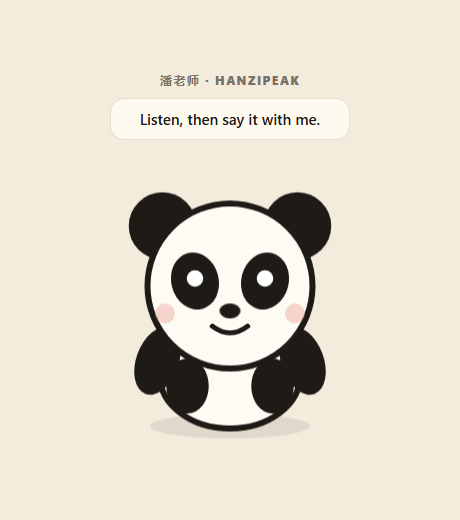
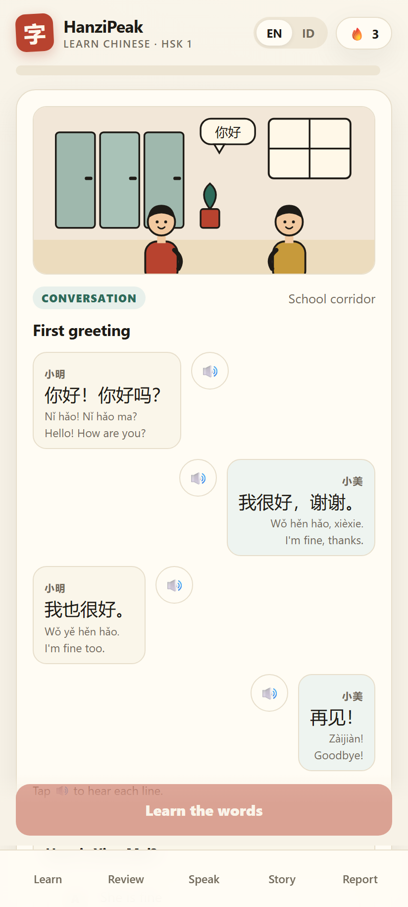
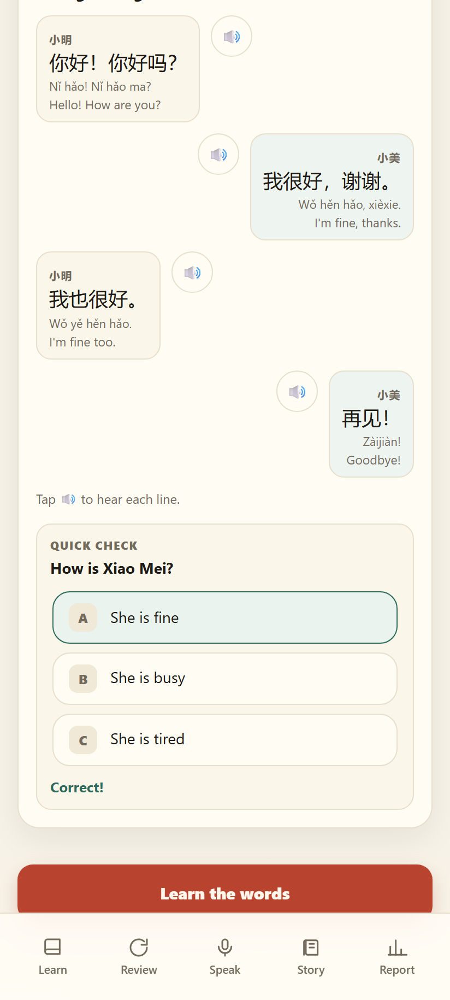
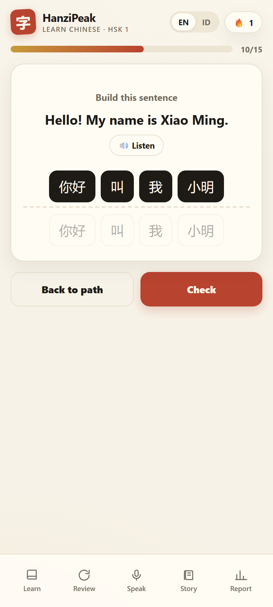
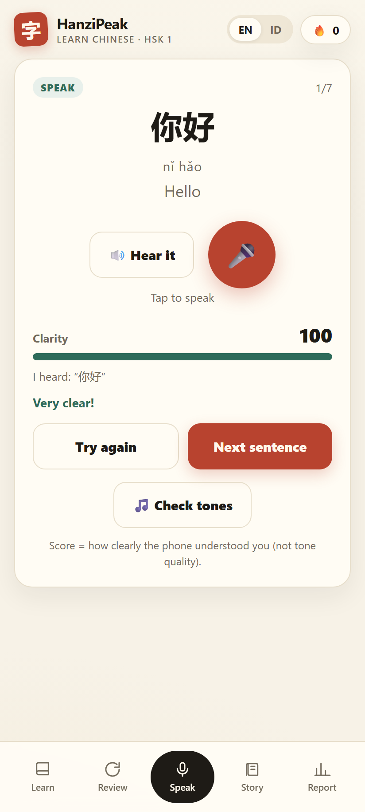

# HanziPeak

A free, fast, bilingual (English / Indonesian) **Android app** for learning Mandarin — HSK 3.0
aligned, spaced-repetition driven, and built to feel like a game.

> **Status: v3.3.1 — HSK 2 complete, Android TV layout tuned for 1080p.**
> HSK 1: 30 illustrated lessons · HSK 2: 75 lessons / 746 words · panda gestures · conversation scoring · offline.
> **Package:** `com.hanziquest.app` *(kept unchanged so every build updates in place).*

## Try it on your phone

**APK:** [`dist/HanziPeak-3.3.1-tv-debug.apk`](dist/HanziPeak-3.3.1-tv-debug.apk) — 4.5 MB
**SHA-256:** `C47A11A915313A65A2CAC664B58075763C8E298C71E19988CC490C57D4995DBF`

```powershell
& 'C:\Android\Sdk\platform-tools\adb.exe' install -r dist\HanziPeak-3.2.0-debug.apk
```

## Course scope

| Course | Words | Lessons | Scenes |
|---|---|---|---|
| HSK 1 | 300 | 30 | unique art for all 30 |
| HSK 2 | 746 | 75 | unique art for all 75 |

Art pass v3.2 added 30 new illustrations for lessons 46–75 (tourists, sea, snow, gym, zoo,
chopsticks, dumplings, climbing, medicine, exchange students, seasons, festival, connectors,
crowds, weather, SMS, next week…), each with its own correct label.

## HSK 2 progress

| Scope | Words | Lessons | Status |
|---|---|---|---|
| HSK 1 | 300 | 30 | done |
| HSK 2 (now) | 450 | 45 | done |


- Lessons 31–45 add 150 more words (parks, riding, renting, lakes, novels, taxis, guests,
  authors, captains, principals, scientists, computers, supermarkets, hospitals…).
- Art for 31–45 reuses the scene library; **the old speech bubbles inside reused art still show
  their original words** (e.g. 天气 in the park scene). A dedicated art pass will fix labels.
- Glosses remain machine-drafted with manual overrides for the worst cases.

## Panda gestures (v2.6)

- While a word is on screen, 潘老师 raises his arm and **points at the word**.
- When the audio plays, his head **nods once per syllable** (300 ms per syllable, derived from
  the pinyin) on top of the lip-flap.
- Both gestures stack with the mood animations (happy, sad, cheer, thinking).
- The nod is a visual beat, not true audio lip-sync — it uses the syllable count, not the real
  timing of the TTS engine.

## What is new in v2.5

- **HSK 2 gets 10 new illustrations** (office desk, water shelf, café week, letter, teamwork,
  lightbulb idea, information centre, clock/classroom, TV news, graduation) — every HSK 2 lesson
  now has a scene of its own.
- **潘老师 appears on every lesson scene**, in both courses. He bobs and flaps while audio plays,
  turns happy when the comprehension answer is right and sad when it is wrong.
- **Conversation practice** in the Speak tab: hear a question, answer aloud, and get a score built
  from recognizer clarity + how many expected keywords you used. The panda reacts to the score,
  and a sample answer is shown for comparison.
- Conversation scoring is a training heuristic: it does not judge grammar, and it depends on the
  phone's speech recognizer and a quiet room.

## Panda teacher (v2.1–2.2)



Live demo: open [`docs/panda-demo.html`](docs/panda-demo.html) in a browser — it cycles through
idle, happy, sad and cheer every 1.4 s.

- Inline SVG panda, no image assets, ~2 KB.
- Idle **bobbing**, periodic **blink**, mouth **lip-flap while the TTS audio plays**, gentle **nod** when happy.
- **Happy** face on a correct answer, **sad** face on a wrong one, **cheer + wave** on completion.
- Named **潘老师** in the lesson bubble, the completion card and the tone feedback.
- **Tone reactions:** above 80 → happy + "lovely tones", 55–80 → thinking + "keep the shape",
  below 55 → sad + "try again, slower".
- 小墨 still hosts the home screen; 潘老师 lives inside the lessons.
- All motion is CSS and switches off under `prefers-reduced-motion`.

## HSK 2 (v2.0, beta)

- **HSK 1 / HSK 2** switch at the top of Learn; the choice is remembered.
- **150 new words** in **15 lessons**, frequency-ordered from the HSK 3.0 level-2 list,
  excluding everything already taught in HSK 1.
- Lessons go straight to **word teaching + quiz + FSRS review**; there is **no conversation
  scene or dialogue yet** — those come in batches (5 lessons at a time) exactly like HSK 1.
- Word glosses are machine-drafted with manual overrides for the worst cases; word order is
  frequency-based, so early lessons lean on grammar words (啊, 让, 但…). Both are slated for a pass.

## Backup reminder (v1.6)

On the Report screen, if you have finished at least one lesson and have not exported a backup in
7 days, a **Back up your progress** card appears. *Back up now* downloads the JSON and starts the
7-day clock; *Later* hides it for the session.

## Android TV / set-top box`n`nThe same APK now runs on phones **and** Android TV (tested against Android 10+ manifest rules):`n`n- declares `LEANBACK_LAUNCHER` with a 320x180 banner, and marks touchscreen/leanback as not required;`n- D-pad keys are forwarded from native Android to the web UI: arrows move focus, OK/Enter activates;`n- focus ring is enlarged for 10-foot viewing.`n`nSideload with ADB over the network:`n`n```powershell`n& 'C:\Android\Sdk\platform-tools\adb.exe' connect <TV-IP>:5555`n& 'C:\Android\Sdk\platform-tools\adb.exe' install -r dist\HanziPeak-3.3.0-tv-debug.apk`n```

## Local account

No server, no email — progress stays on the device.

- **Report → Account** → create a name and a PIN (4+ digits).
- The PIN is stored as a SHA-256 hash, never in plain text.
- **Sign out** locks the app; the unlock screen asks for the PIN at the next cold start.
- **Export / Import backup** (JSON) moves progress to another phone or keeps a safety copy.
- Progress itself is unchanged: it remains in local storage and survives app restarts and updates,
  but **not** uninstalling the app or losing the phone. For that, a cloud account is needed later.

The old Supabase integration was removed; [`docs/CLOUD.md`](docs/CLOUD.md) is kept as a future option.

Installs over v0.2.0 / v0.2.1 (same package, versionCode 4). Android 6+, debug-signed.
If audio is silent: Learn screen banner → **Install voice**.

## Why "HanziPeak"

- **9 HSK levels → 9 peaks.** The journey map, checkpoints, and future boss battles all read naturally.
- Short enough for a launcher icon, distinctive enough to search, and not locked to one feature
  (unlike "Four Tones") or one script (unlike generic "Hanzi…" names).
- Pairs with the descriptive subtitle used in-app: **HanziPeak · Learn Chinese · HSK 1**.

Quick web/DNS check: no existing product found, `hanzipeak.com` / `.app` unregistered.
*Not legal clearance* — do a trademark search before a store launch.

## What the HSK 1 course includes

| Piece | Status |
|---|---|
| Vocabulary | **HSK 1: 300 words · HSK 2: 746 words** (HSK 3.0 lists) |
| Course | **HSK 1: 30 lessons · HSK 2: 75 lessons**, 10 words each, sequential unlock |
| Lesson flow | 10 teach cards → 15-question quiz (recognition / production / listening) |
| Spaced repetition | **FSRS** (`ts-fsrs`) — review tab, due badges, per-skill cards |
| Review timing | Recognition due immediately after a lesson; production next day |
| Progress | XP, streak, coverage, mastered words, accuracy, ability estimate |
| Languages | English ↔ Indonesian, remembered per device |
| Audio | Phone's native Mandarin TTS, offline |
| Story | One short graded story with tap-to-gloss |

## Engagement (v0.3)

The first launch now asks you to start instead of showing a dashboard:

- **Welcome screen** — 小墨 introduces himself, one big CTA: "Start your first 5 minutes".
- **Home hero** — mascot, a plain-language greeting, a big start button, and today's XP goal.
- **"Try one word"** — a real 3-option micro-exercise on the home screen; correct = +5 XP.
- **Lessons** — audio-first word cards with progress dots, then a 15-question quiz that includes
  **sentence building** (tap the words in order), combo counter, and immediate feedback.
- **Celebration** — stars, mascot reaction, and XP before the report.
- Indonesian is the default when the phone's language is Indonesian.

## Tone scoring (v1.1)

The Speak tab now has **Check tones** next to the clarity mic:

- Records ~2.6 s, extracts the pitch contour on-device (autocorrelation, 8 kHz).
- Splits the voiced part by syllable and compares each shape with the expected tone:
  flat (1), rising (2), dip (3), falling (4).
- Shows an overall tone score, a contour sparkline, and a row per syllable with
  target tone, detected shape, and points.
- Works offline, no audio leaves the phone.

**Honest limits:** this is a heuristic trainer, not an exam-grade pronunciation score.
It needs a quiet room, a clear voice, and it cannot fully separate tone from voice quality.
The synthetic self-test scores 99 for a correct 1-2-3-4 contour and 21 for an all-falling one.

## Stroke order & writing practice (v1.3)

On every word card there is a **✍️ Stroke order** button:

- Opens a large character with the stroke outline.
- **Play animation** draws each stroke in order (Hanzi Writer).
- **Practice writing** starts a quiz: draw with your finger; each stroke is validated for
  order and direction, the next stroke is revealed after 2 misses, and a counter tracks progress.
- Multi-character words get tabs (e.g. 你 / 好) so each character is practised separately.
- 252 stroke-data files (every character used in the course) are bundled — 0.5 MB, fully offline.

## Polish (v1.1–1.2)

- **Reset progress** on the Report screen (double-tap to confirm) clears lessons, cards, and streak.
- **Icon navigation** (book, refresh, mic, scroll, chart) with a stacked mobile tab bar.
- **Daily-goal completion state** — the mascot bubble turns green when you hit 50 XP.
- Confetti + star pop on lesson completion, correct-answer pop, smooth goal-bar fill, card hover lift.
- Serif hanzi typography, focus-visible rings, `touch-action: manipulation`.
- Speak tab now shows clarity first, then tone practice — matching the order you actually do them.
- All motion disabled under `prefers-reduced-motion`.

## Speaking practice

A dedicated **Speak** tab with on-device speech recognition:

- 7 sentences from HSK 1 patterns: hear the model (TTS) → tap the mic → read it aloud.
- The phone transcribes you, and the app scores **clarity** (how much of the sentence was
  recognized) with character-level alignment.
- Shows what it heard, a score bar, and feedback; attempts/best are stored per sentence.
- Needs `RECORD_AUDIO` permission. Uses the device's speech service (Google app on most phones).
  If none is available, the app explains it and still lets you listen and repeat.

**Honest limitation:** this measures *intelligibility to the recognizer*, not tone quality.
Wrong tones often cause misrecognition, so it is an indirect tone check. Real tone scoring needs
pitch-contour analysis (planned) or a cloud pronunciation API (needs a backend/key).

## Conversation-first lessons (v0.5)

Every lesson now opens with a **situation**, not a word list:

1. **Illustrated scene** — original inline SVG art, one per unit: language school, living room,
   classroom, café, train platform, airport. No photos, no external assets, ~10 KB each.
2. **A 4-line dialogue** in Chinese with pinyin + translation, audio on every line.
3. **A quick comprehension check** — one question about the dialogue; "Learn the words" unlocks
   after you answer, so the conversation is read, not skipped.
4. **"Learn the words"** — then the 10 word cards, then the quiz and sentence building.

The opening dialogue only uses words from the first lessons (你好, 好, 吗, 我, 很, 谢谢, 你, 呢, 也),
so a beginner can actually read it. Later unit dialogues use words taught up to that unit.

**Stage 2 (v0.7):** lessons 1–5 now have their **own** dialogue (first greeting → who is she →
at school → trip to China → learning to write). The first 50 words were re-ordered to match those
conversations, so each dialogue is readable with the words just taught. Lessons 6–30 still use their
unit scene as a fallback.

**Stage 3 (v0.8–1.0):** **all thirty** lessons have their **own illustration** and dialogue.
L11–L15 vocabulary was re-ordered so concrete words (weather, time, work, directions) come before
particles (就, 着, 地, 起来). All art is inline SVG, no external assets, ~10 KB each.

## Screenshots

| Scene | Check | Lesson | Speak |
|---|---|---|---|
|  |  |  |  |

## What is still missing

- **Native review of the content** — 100 core glosses are hand-written; ~200 tail glosses are
  machine-drafted and not yet checked by a native speaker.
- **Baked audio**, cloud accounts/sync, and HSK 3–9.

## Repo map

| Path | What it is |
|---|---|
| [PLAN.md](PLAN.md) | Product & technical plan |
| [docs/ASSESSMENT.md](docs/ASSESSMENT.md) | How ability is graded against HSK |
| [docs/ANDROID.md](docs/ANDROID.md) | APK build, toolchain traps, TTS options |
| [ATTRIBUTION.md](ATTRIBUTION.md) | Data licenses (HSK list, CC-CEDICT) |
| [app/](app/) | Next.js + Capacitor source |
| [app/lib/words.ts](app/lib/words.ts) | The 300-word HSK 1 dataset (generated) |
| [app/tools/build-content.mjs](app/tools/build-content.mjs) | Content pipeline |
| [prototype/index.html](prototype/index.html) | Early visual prototype |
| [dist/](dist/) | Built APK |

## Build

```powershell
cd app
npm.cmd run build
node node_modules\@capacitor\cli\bin\capacitor sync android
$env:JAVA_HOME = 'C:\jdk17\jdk-17.0.20.1+1'
& 'C:\Users\eddys\.gradle\wrapper\dists\gradle-8.10.2-all\7iv73wktx1xtkvlq19urqw1wm\gradle-8.10.2\bin\gradle.bat' -p android assembleDebug --no-daemon
```

Details: [docs/ANDROID.md](docs/ANDROID.md).
